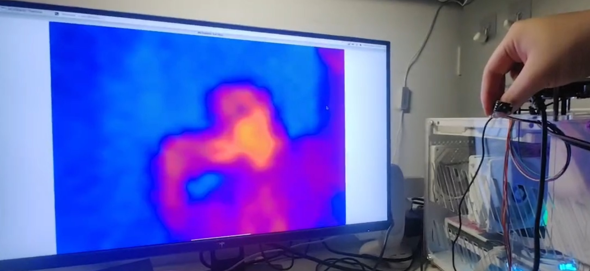

  

<h1 align="center">张恒玮 · Hengwei Zhang</h1>

  <strong>嵌入式软件开发 · ARM Linux / 裸机 · 端侧感知</strong> 
  北京理工大学 · 电子信息工程本科（2023–2027）

  <a href="#代表项目">代表项目</a> ·
  <a href="#专利与竞赛">专利与竞赛</a> ·
  <a href="https://vivofiftykfc.github.io/">个人博客</a> ·
  <a href="https://github.com/vivofiftykfc/embodied-intelligence-portfolio">作品集</a> ·
  <a href="mailto:zhangdeyou_2023@qq.com">邮件联系</a>

我喜欢把传感器、算法和设备接起来，在实机上验证结果。从 ARM Linux 上的离线声纹识别，到 Cortex-A8 裸机上的显示驱动，再到飞腾和树莓派上的视觉部署，我关注的是数据进来之后，怎样在设备上变成能用的结果。

## 代表项目

<table>
<tr>
<td width="50%" valign="top">
<h3><a href="https://github.com/vivofiftykfc/sound-walker">Sound-Walker</a></h3>

<strong>ARM Linux · 离线声纹识别</strong>

在同一设备上跑通纯 C 的 MFCC + DTW 与 CAM++ 两种方案，完成录音、注册与本地匹配。项目测试中，两版识别延迟各约 <strong>200 ms</strong> 和 <strong>500 ms</strong>。

<a href="https://github.com/vivofiftykfc/sound-walker#路线对比">查看对比</a> · <a href="https://www.bilibili.com/video/BV1HJ7P6oE8r/">演示视频</a>

</td>
<td width="50%" valign="top">
<h3><a href="https://github.com/vivofiftykfc/cicc_9">火灾救援无人机</a></h3>

<strong>飞腾 Linux · 视觉与感知模块负责人</strong>

用 ncnn 部署 NanoDet，处理红外热阵列数据，参与视觉、红外与通信模块联调。获<strong>集创赛飞腾赛道华北赛区二等奖</strong>。

<a href="#飞腾平台实机联调">查看实机调试</a>

</td>
</tr>
<tr>
<td width="50%" valign="top">
<h3>Cortex-A8 裸机图形界面</h3>

<strong>S5PV210 · LVGL 移植与显示驱动</strong>

适配显示驱动，通过帧缓冲缓存、双缓冲与垂直同步优化图形刷新。

</td>
<td width="50%" valign="top">
<h3>电梯智能监控</h3>

<strong>树莓派 5B · 校级大创项目负责人</strong>

负责 NanoDet 选型与部署，协调检测与语音报警模块联调。电动车入梯检测样机在结题演示中的处理速度约为 <strong>10 FPS</strong>。

</td>
</tr>
</table>

### 飞腾平台实机联调

  
   
  红外热阵列采集与热像显示 · <a href="./assets/phytium-prototype.jpg">查看飞腾平台与传感器接线实拍</a>

## 专利与竞赛

**[基于 ESP32 的独居老人智能家居健康云监测系统（CN121547473A）](https://patents.google.com/patent/CN121547473A/zh)**

发明专利申请于 2026 年 2 月公开，我是共同发明人，申请人为北京理工大学。

项目中，我负责毫米波雷达串口采集和人体关键点跌倒检测流程，参与雷达与视觉的数据对齐和融合判据设计，并用示例监测数据验证了建议生成与语音播报流程。[查看 RAG 决策原型](https://github.com/vivofiftykfc/qwen_rag)

- 第九届全国大学生集成电路创新创业大赛 · 飞腾赛道华北赛区二等奖
- 2026 年美国大学生数学建模竞赛（MCM）· Honorable Mention（H 奖）

<strong>更多项目</strong>

- [StellarVanguard-FPGA](https://github.com/vivofiftykfc/StellarVanguard-FPGA) · 用 Verilog 在 Basys3 上实现交互式游戏，输出 640×480、60 Hz VGA 画面。
- [fpga-busicdc-2025](https://github.com/vivofiftykfc/fpga-busicdc-2025) · AXI-Stream 网络协议解析与 8 位单总线处理器。
- [JudgeBooth](https://github.com/vivofiftykfc/judgebooth) · 负责 FastAPI 后端、SSE 实时反馈和多模态评审流程集成。
- [WLAN-0714 ARG](https://github.com/vivofiftykfc/wlan-0714-arg)、[ARG Toolbox](https://github.com/vivofiftykfc/arg-toolbox)、[Contemplation Site](https://github.com/vivofiftykfc/contemplation-site) · 交互叙事、故事建模与阅读体验实验。

  

